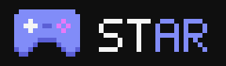

  

# Playdex

Track, rate and review video games, build lists with friends and follow what they play.

Live at [playdex.sirblob.co](https://playdex.sirblob.co).

## Features

### Games

- Search and discover games, with details, screenshots, artwork and trailers from IGDB
- A releases page with games out in the last 30 days and games with a set release day in the next 90 days, refreshed daily from IGDB
- A search box that opens from the header, the phone tab bar, `/` or Ctrl+K, with games, players and pages in one list. Start with `@` to only search players or `>` to only search pages
- Filter game searches with `before:`, `after:` and `year:` for release dates, `by:`, `dev:` and `pub:` for studios, and `genre:`, `platform:` and `theme:`. Use quotes for names with spaces, like `dev:"team cherry"`. Filters show as chips in the search box and also work on the Discover page
- Filter a game's reviews by rating and by the reviewer's playtime. Each review shows the reviewer's library status and playtime
- Game pages show time to beat, store links, DLC, expansions, editions, remakes and remasters, age ratings, game modes, perspectives and themes from IGDB
- Similar games from IGDB when no players have rated a game yet
- Link preview images for games, profiles and lists, so shared links look good in Discord and other apps
- Community media: players can add gameplay screenshots, fan art and YouTube videos to any game page. New media is shown publicly once a moderator approves it
- Browse a game's screenshots, artwork, gameplay and fan art in a full screen image slider
- Image uploads show a preview of the picture before you send it
- Export a game card image with your rating, review and playtime, styled with your profile colors and fonts
- Submit missing games and suggest edits to any detail, including store links, videos, a banner, screenshots and artwork, or pick images to remove. Moderators review them before they go live, and edits stay when a game refreshes from IGDB
- Crop a cover, banner, screenshot or artwork before it uploads in Suggest an edit and Submit a game, or keep the original image
- Game series: filled in from IGDB and linked by players from Suggest an edit. Each game page shows the rest of its series, and new links are approved by a moderator
- The Suggest an edit form reminds players to also fix the game on IGDB, so the change reaches every site that uses it
- Hover over a game cover on the homepage, discover, game pages, profiles and review cards to see its genres, platforms, developers, publishers, release date, summary, ratings and time to beat
- Hover over a Playdex rating to see a bar chart of how players rated the game
- An account setting to show, blur or hide adult games across the whole site
- A homepage with continue playing, popular games, picks from your friends, new and upcoming releases, recent reviews, fresh lists and the total playtime of every player

### Library

- Statuses: Playing, Paused, Played, Backlog, Wishlist and Dropped
- Half star ratings, reviews and playtime
- Quick add from any game card. Picking Playing, Paused, Played or Dropped opens a dialog to rate the game and write an optional review
- Write reviews and comments with formatting, lists, quotes and links. Images and other media can't be added
- Hide part of a review or comment behind a spoiler, or mark the whole review as a spoiler, and mark other reviews as helpful
- Star your favorite games and pick a current obsession to show on your profile
- Filter, search and sort your library from the dashboard, with your filters and view remembered
- Note the platform you own each game on and add your own tags, then filter by them
- Select several games at once to change their status, tag them, set their platform or remove them
- Undo a status change or removal right after you make it
- See about how long your backlog will take to beat
- A stats page with charts for the games you added and finished each month, genres, platforms, ratings and release decades, plus a year wrapped image in your profile style
- Wishlisted games notify you when they come out
- Hide any game from your profile, along with its review and activity, one at a time or many at once

### Profiles

- Public profile with your library, reviews, activity, friends and lists
- Friend count, playtime total and linked gaming profiles in the header
- Badges for big libraries, finished games, reviews, playtime, public lists and friends, given as Discord roles
- Players without a profile picture get a pixel character that matches their name, or can pick any of the characters
- Hover over a player's name or picture to see a profile card in their own colors and background, with their bio, stats and what they are playing
- Your Discord status and the game you are playing, shown in the Discord card and a Discord status widget
- Friend cards with tagline, game count and how long you have been friends
- An Overview tab built from widgets you pick, arrange and resize: favorites, all games, games by status, top rated, most played, stats, reviews, activity, lists, friends, comments and text blocks
- Text blocks with formatting, links, uploaded images and GIFs from Giphy or Tenor, which can be resized, aligned and wrapped by text
- Choose how your games are sorted: by status, playtime, rating or recently updated
- Visitors can open a sort and search panel on any games tab of a profile to search games by name and sort by rating, playtime, status or recently updated
- Starred games stand out with a gold border
- Friends can leave comments on your profile
- Customize colors for dark and light mode, fonts, layout, cover image and background
- Generate a profile theme from the colors of your background image, with matching dark and light palettes
- Pick which tabs show on your profile and which one visitors see first
- Privacy settings for every part of your profile
- Compare your library with another player: taste match, shared games, biggest disagreements and what they loved that you have not played

### Creator dashboard and marketplace

- A creator dashboard for everything you make: your profile, appearance, widgets, themes, profile pictures, backgrounds, submissions and uploaded media
- Turn your profile look into a theme, with its colors, fonts, layout, banner and background, and share it publicly or keep it private
- Share profile pictures and profile backgrounds that other players can use, publicly or kept private
- Link themes, profile pictures and backgrounds to up to 5 games
- A marketplace, linked from the footer, to search and browse themes, profile pictures and backgrounds by popularity or newest, and apply them in one click
- Picked for you: the marketplace recommends themes, pictures and backgrounds made for games you are playing or have played
- Applying a theme makes your profile match it exactly, including removing your banner or background when the theme has none
- Official Playdex themes with pixel art banners and tiled backgrounds: Playdex Classic, Arcade Night, Pocket Green, Slime Meadow, Dragon Ember, Ghost Light and Coin Rush

### Friends and feed

- Send and accept friend requests
- Reply to reviews
- A feed of your friends' activity with likes and comments, shown as cards, a compact list or a cover grid
- Steam imports in the feed show the covers and names of the games that were added
- Notifications for likes, comments, review replies, profile comments, friend requests, list invites, reviewed submissions, wishlisted games coming out, and friends reviewing a game you own or starting a game on your wishlist
- Live updates over websockets: the feed, notifications and shared lists refresh on their own when something changes
- The feed loads older activity as you scroll
- Notification settings: turn each kind on or off for the site, email and push, mark single notifications read, dismiss them one at a time or clear them all, and similar likes and comments are grouped
- Browser push notifications on any device where you turn them on
- Email notifications with a pixel art space banner and starfield background, styled like the rest of Playdex
- Email summaries, weekly by default or daily, with wishlisted games that came out or are coming soon, waiting friend requests, new comments and likes. Summaries are only sent when there is something new and stay inside the daily email limit
- Recommendations: games that fans of a game also liked, and what is popular with your friends this week

### Journal

- Write play journal and blog posts with the rich text editor, spoilers and up to 20 uploaded images
- Attach up to 5 games to a post, and it shows on each of their game pages. Game pages have a button to write about that game
- Make a post public or keep it private as a note or draft
- Read the newest posts on the Journal page, or every post by one player from the Journal tab on their profile

### Lists

- Create lists and share them on the Lists page, your profile, or only with friends
- Visibility options: Public, Unlisted, Friends and Private
- Invite friends to build a list together. Everyone on a list can add games, rate them, share thoughts and edit list settings
- Organize games into groups and drag and drop to reorder them
- List, grid, board and tier list views, with a default view per list
- See who else is viewing a shared list right now
- Search and filter games on a list, for example to only show games you have played
- Customize a list with an accent color, background color and background image
- Export a list wrapped image that sums up the list and its ratings
- An Activity tab that shows who added or removed games, shared thoughts, ranked tiers, and joined or left the list

### Site settings

- Site themes for the whole app: Cerberus, Flats, Tokyo Night, Night Cat, Catppuccin, Arch Linux, Gruvbox, Nord, Kanagawa, Wintry and Rose
- A site wide light mode with its own theme choice: Playdex Light, GitHub Light, Frost, Sakura, Catppuccin Latte, Rose Pine Dawn, Tokyo Night Day, Gruvbox Light, Nord Snow and Kanagawa Lotus
- Accessibility settings: reduce or keep motion, color blind friendly palettes and grayscale, high contrast, larger text, underlined links, simpler headings and a stronger focus outline
- Dates and times follow your browser time zone, or a time zone you pick in your profile settings
- A features page that sums up what Playdex can do
- Installable as an app, with game pages and your library cached for offline use. Phones get a banner to add Playdex to the home screen, with an install button on Android and Share steps on iPhone
- A header with Discover, Releases, Feed and a Community menu for Lists, Journal and Marketplace
- An account menu grouped into Games, Social and Settings, with your profile, dashboard, library, lists, reviews, stats, journal, friends, notifications, creator dashboard, settings, connections, site theme and help
- A bottom tab bar on phones with Library, Feed, Search, Alerts and Profile that stays clear of the home indicator, a mobile menu with a Browse grid and your pages in the same Games, Social and Settings groups, and loading placeholders while pages load
- Keyboard shortcuts: `/` or Ctrl+K to search, `g` then a letter to jump to a page, `w` to write a journal post and `?` for the full list
- Empty pages point you to what to do next, like importing from Steam or finding players
- Notifications are grouped by day and show the cover of the game they are about
- Animated pixel art characters around the site: beside page headings, on section headers, on forms, in empty states and on the footer
- Tooltips that work with a mouse, keyboard focus or a long press on phones
- Error pages with pixel art characters and a message for each kind of error, and an offline page for when there is no connection

### Help and safety

- Block players so they cannot send you friend requests, comment on your profile or activity, reply to your reviews or send you notifications
- A contact page for questions, reports, bugs and feedback, with formatted text and screenshots. Replies arrive as a notification, or by email for visitors who are not logged in
- Terms of Service, Privacy Policy and Community Guidelines pages, linked from the footer

### Account and security

- Two-factor sign in with an authenticator app, with recovery codes
- Sign in with a code sent to your email, verify your email and reset a forgotten password by email
- See every device you are signed in on, with the browser, version, system and phone model where available, and sign any of them out
- Download your data as JSON, or your library and lists as CSV

### Connections

- Connect Steam by signing in on Steam's own site, then import your owned games, playtime and wishlist. They sync automatically unless you turn it off, and you can sync by hand once every 30 minutes
- Log in, sign up and link your account with Discord
- The Playdex Discord bot: players in the Playdex server who linked Discord get games they play added to their library, playtime tracked from their sessions, Discord roles for their badges, and `/playdex profile`, `game`, `backlog` and `random` commands
- Link Xbox, PlayStation, Nintendo Switch, Epic Games, Battle.net, GOG, itch.io and RetroAchievements profiles

### Admin and moderation

- Moderators edit any game detail and moderate reviews, comments and submissions
- An audit log of every admin and moderator action, kept for a year
- A Discord page with the bot's connection, linked players, games it added, badge roles, and activity names to match to games or ignore
- Submissions are listed compactly with status and type filters, and each one is approved or rejected from its own page
- Admin pages are grouped into Overview, Moderation, Community, Games and System tabs
- Admins also manage players and their roles, lists, storage and a live download queue that can be stopped, resumed or cleared
- Account creation settings: turn sign ups on or off, allow or block Discord sign ups, require a sign up code and block email domains
- Admins can see and remove the blocks a player has made
- A marketplace moderation page for themes, profile pictures and backgrounds: search, filter by visibility, make items private, clear their game links or delete them
- Admins can add games to any player's library
- Steam library sync from the queue page: on by default, pick how often it runs and see the requests used today. Profiles are checked 100 at a time, private profiles and players who have not played since the last sync are skipped, and syncs stay under Steam's 10,000 requests a day
- A visitors page with stats from Umami: visitors, visits, page views, bounce rate, average visit time, visitors online now, a visitors chart and top pages, referrers, countries, browsers and devices
- The storage page loads right away while usage is scanned in the background, and can queue every game with missing images at once
- An email page with SMTP status, a log of every email sent and a button that sends a test of every email template to yourself
- At most 100 emails are sent a day. Notification emails stop at 80 so the last 20 stay free for sign in, verify and password reset codes, and emails over the limit show as skipped in the log
- Reviews show spoilers and helpful votes to moderators, who can mark a review as a spoiler or clear its votes
- Activity comments, profile comments and list thoughts are moderated from one comments page
- A security tab on each player shows email verification, two-factor sign in, every signed in device and the emails they were sent
- Admins can pause a player's email notifications, reset their time zone, site colors and visible tabs, and clear or remove profile widgets
- Admins can change a player's adult game setting, accessibility settings and pixel character picture
- Contact messages show up in the admin panel, where moderators and admins read them, change their status and reply

## Support

If you enjoy Playdex, you can support it on [Ko-fi](https://ko-fi.com/sirblob).

